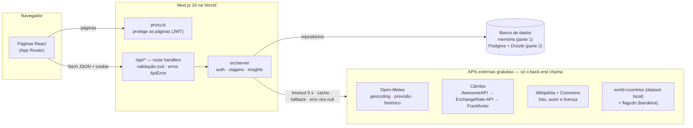
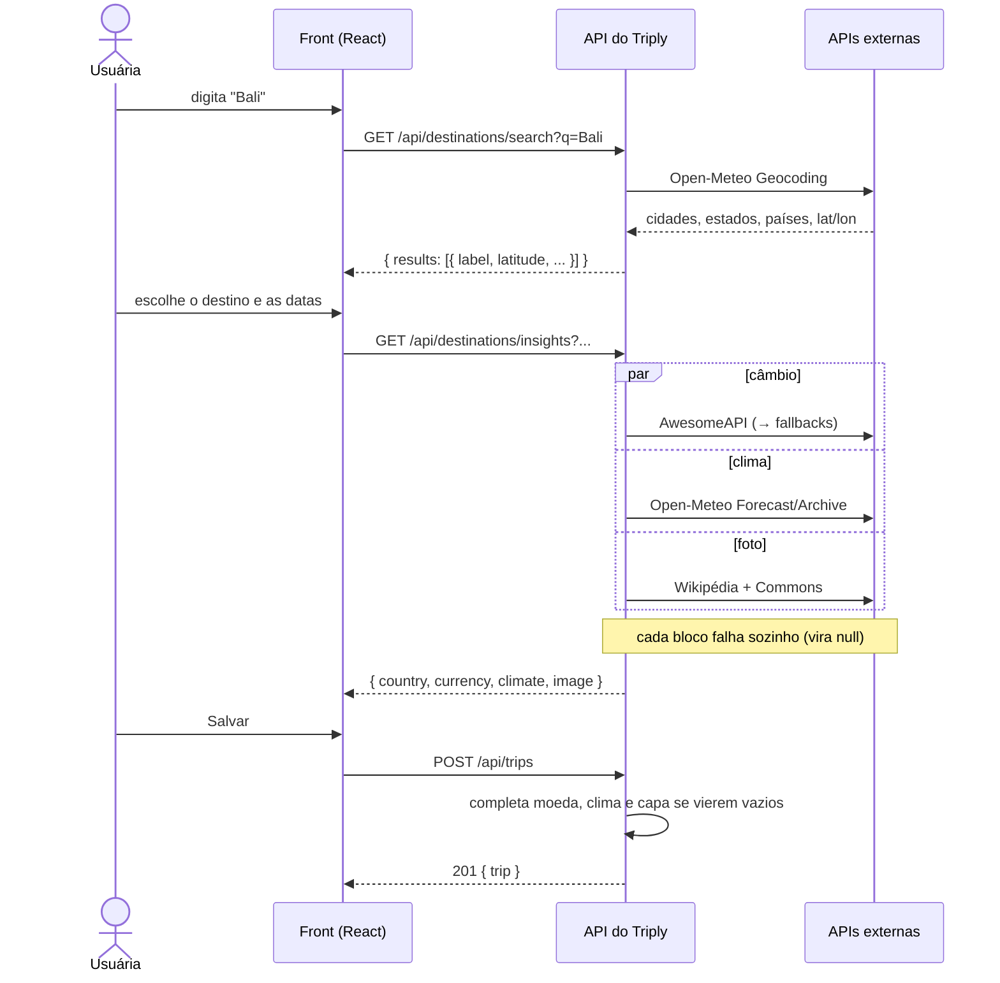

# Triply

**Planeje, viva e registre suas viagens.** O Triply é um web app responsivo em que a pessoa planeja viagens, descobre moeda, cotação e clima do destino e, depois de viajar, registra como foi — o perfil mostra as viagens realizadas e quantas cidades e países já foram visitados.

Trabalho da disciplina **DSW3 – Desenvolvimento Web 3**. O protótipo original é mobile (Figma); aqui ele foi adaptado para web, *desktop first* e funcionando bem no celular.

| | |
|---|---|
| 📚 **Documentação interativa da API** | [`/api-docs`](http://localhost:3000/api-docs) (OpenAPI 3.1, com "Try it") · spec em [`/api/openapi.json`](http://localhost:3000/api/openapi.json) |
| 📖 **Referência dos endpoints** | [`docs/API.md`](docs/API.md) |
| 🧭 **Arquitetura e APIs externas (página do app)** | [`/sobre`](http://localhost:3000/sobre) |
| 📐 **Especificação do produto** | [`docs/SPEC.md`](docs/SPEC.md) |

*(Os links `localhost` funcionam com o app rodando — veja [Rodando localmente](#rodando-localmente). Em produção, use o domínio da Vercel.)*

## Sumário

- [Requisitos da disciplina atendidos](#requisitos-da-disciplina-atendidos)
- [Telas e funcionalidades](#telas-e-funcionalidades)
- [Stack](#stack)
- [Arquitetura](#arquitetura)
- [Rodando localmente](#rodando-localmente)
- [Usuária de demonstração](#usuária-de-demonstração)
- [API própria](#api-própria)
- [APIs externas consumidas](#apis-externas-consumidas)
- [Deploy na Vercel](#deploy-na-vercel)
- [Segurança](#segurança)
- [Estrutura do projeto](#estrutura-do-projeto)
- [Créditos e licenças](#créditos-e-licenças)

---

## Requisitos da disciplina atendidos

| Requisito | Como o Triply atende | Onde ver |
|---|---|---|
| **1. APIs próprias** para o front se comunicar com o back | API REST/JSON em `/api/*` (Next.js route handlers): autenticação por cookie, perfil, CRUD de viagens, conclusão em lote, upload de capa e rotas de destinos. Contrato de tipos único em [`src/types/api.ts`](src/types/api.ts); erros sempre no mesmo formato (`ApiError`, em pt-BR). **15 operações documentadas em OpenAPI 3.1.** | [`/api-docs`](http://localhost:3000/api-docs) · [`docs/API.md`](docs/API.md) |
| **2. Consumo de API externa (gratuita)** | O **back-end** consome 6 provedores gratuitos — Open-Meteo (geocodificação, previsão e histórico), AwesomeAPI, ExchangeRate-API e Frankfurter (câmbio), Wikipédia e Wikimedia Commons (imagem e créditos) — e os expõe ao front só por rotas próprias (`/api/destinations/*` e enriquecimento automático das viagens). Timeout, cache, *fallback* e tolerância a falhas. | [APIs externas](#apis-externas-consumidas) · `src/server/external/` |
| **3. Hospedagem na Vercel** | Deploy na Vercel. Na **parte 1** o app usa um **banco em memória** (sem nenhum banco para provisionar); o código do PostgreSQL gerenciado (Neon) já está no projeto, pronto para a **parte 2**. | [Deploy na Vercel](#deploy-na-vercel) |

## Telas e funcionalidades

| Rota | Tela | Acesso |
|---|---|---|
| `/login` · `/cadastro` | Entrar e criar conta | público (logado → `/perfil`) |
| `/perfil` | Perfil com estatísticas (cidades e países) e as viagens realizadas | protegido |
| `/viagens/[id]` | Detalhe da viagem realizada: hospedagem, atividades, período, cotação, temperatura, gastos e relato | protegido |
| `/planos` | Planos de viagem (planejadas) | protegido |
| `/planos/novo` · `/planos/[id]` | Planejar e editar viagem — **destino com autocomplete** e painel "Sobre o destino" (bandeira, moeda e cotação, clima, foto) alimentado pelas APIs externas | protegido |
| `/registrar` | Marcar viagens como realizadas, com avaliação, companhia, gastos e relato | protegido |
| `/sobre` | Arquitetura, endpoints e APIs externas (útil na apresentação) | público |
| `/api-docs` | Documentação interativa da API | público |

## Stack

| Camada | Escolha |
|---|---|
| Framework | **Next.js 16** (App Router, route handlers, `proxy.ts`, Cache Components), **React 19**, **TypeScript** |
| Estilo | Tailwind CSS v4 (tokens do design system em `src/app/globals.css`), `lucide-react`, `sonner` |
| Banco | **Parte 1: banco em memória** (padrão — `DB_DRIVER=memory`; já nasce com os dados de demonstração). **Parte 2: PostgreSQL** (local e Neon) + **Drizzle ORM** e `drizzle-kit` para migrações (`DB_DRIVER=postgres`). Os dois ficam atrás da mesma camada de repositórios. |
| Validação | **zod v4** |
| Autenticação | e-mail + senha com **bcryptjs**; sessão em **JWT** (`jose`, HS256) num cookie `httpOnly` |
| Datas | `date-fns` |
| Documentação da API | **OpenAPI 3.1** + Scalar API Reference (CDN, versão fixa com SRI) |
| Hospedagem | **Vercel** |

## Arquitetura



**Fluxo "planejar uma viagem"** — onde as APIs próprias e as externas se encontram:



Decisões que valem citar na apresentação:

- **O front nunca chama API de terceiros** — tudo passa pelo back, que padroniza o formato, esconde detalhes (e eventuais chaves) e aplica cache/timeout.
- **Falha de API externa nunca derruba nada:** cada bloco do `insights` vira `null` isoladamente e salvar uma viagem não depende de nenhuma API externa.
- **Camada de repositórios** (`src/db`): os serviços falam só com interfaces (`UsersRepository`, `TripsRepository`, `LoginAttemptsRepository`); `DB_DRIVER` escolhe a implementação — memória ou Postgres/Drizzle — sem mudar uma linha dos serviços nem as respostas da API. Só `src/db/postgres/**` importa Drizzle/`pg` (o ESLint garante).
- **Isolamento por usuário:** toda consulta filtra pelo `user_id` da sessão; recurso de outro usuário responde `404`.
- **Contrato único** (`src/types/api.ts`) compartilhado por front e back; a especificação OpenAPI é conferida contra as rotas e os schemas zod reais (`npm run docs:check`).

## Rodando localmente

**Pré-requisito:** Node.js 20.9+ (testado com 22). **Na parte 1 não há nenhum banco para instalar ou configurar** — o app usa um banco em memória, que já nasce com os dados de demonstração.

```bash
# 1. dependências
npm install

# 2. segredo da sessão (único valor obrigatório)
cp .env.example .env.local
# edite .env.local e troque JWT_SECRET por uma string aleatória com 32+ caracteres
# (ex.: openssl rand -base64 48). O DATABASE_URL de exemplo é ignorado no modo memória.

# 3. servidor de desenvolvimento
npm run dev          # http://localhost:3000
```

Ao subir, o log mostra qual banco está ativo:

```text
[db] banco em memória — os dados voltam ao estado inicial quando o servidor reinicia
```

Entre com a [usuária de demonstração](#usuária-de-demonstração) e use o app normalmente. **Os dados criados (contas, viagens, capas) ficam só na memória do servidor**: reiniciar o `npm run dev` volta tudo ao estado inicial (a Sarah e suas 7 viagens).

### Modo Postgres (parte 2)

O código do Postgres já está no projeto. Para usá-lo no lugar da memória:

```bash
# banco local (exemplo com Homebrew no macOS; precisa do PostgreSQL 13+)
brew install postgresql@17 && brew services start postgresql@17
createdb triply

# em .env.local, além do JWT_SECRET:
#   DB_DRIVER=postgres
#   DATABASE_URL=postgres://SEU_USUARIO@localhost:5432/triply

npm run db:migrate   # cria as tabelas
npm run db:seed      # grava a usuária demo (mesmos dados e ids do modo memória)
npm run dev          # o log passa a mostrar: [db] PostgreSQL (...) — os dados são persistentes
```

| Variável | Para quê |
|---|---|
| `JWT_SECRET` | Segredo que assina a sessão (HS256). **Obrigatório, mínimo de 32 caracteres**; sem ele a API não inicia sessões. |
| `DB_DRIVER` | `memory` (padrão, quando ausente) ou `postgres`. Qualquer outro valor derruba a subida com uma mensagem clara. |
| `DATABASE_URL` | Só no modo `postgres`: conexão do app. Na Vercel/Neon, use a URL **pooled**. |
| `DATABASE_URL_UNPOOLED` *(opcional)* | Só no modo `postgres`: conexão direta, usada pelas migrações (`drizzle-kit`) quando existir. |

Nenhuma das APIs externas exige chave.

| Script | O que faz |
|---|---|
| `npm run dev` / `build` / `start` | Servidor de desenvolvimento, build e servidor de produção |
| `npm run lint` | ESLint |
| `npm run docs:check` | Confere a spec OpenAPI contra as rotas e os schemas zod |
| `npm run db:generate` | *(modo Postgres)* Gera uma migração SQL a partir de `src/db/postgres/schema.ts` |
| `npm run db:migrate` | *(modo Postgres)* Aplica as migrações em `drizzle/` |
| `npm run db:seed` | *(modo Postgres)* Recria a usuária de demonstração e suas viagens (idempotente) |
| `npm run db:studio` | *(modo Postgres)* Abre o Drizzle Studio (navegador de dados) |

Os scripts `db:*` só valem para o modo Postgres; no modo memória não há nada para migrar nem semear.

## Usuária de demonstração

| E-mail | Senha |
|---|---|
| `sarah@triply.app` | `triply123` |

Ela tem **2 viagens realizadas** (Espanha e França) e **5 planejadas** (Maragogi, México/Tulum, Indonésia/Bali, Barra Grande e Natal), com as fotos de capa do Wikimedia Commons. Os dados estão em `src/db/seed-data.ts`, com **ids fixos**: no modo memória o banco se popula sozinho no primeiro acesso; no modo Postgres, `npm run db:seed` grava exatamente os mesmos registros. Como os ids não mudam, a sessão da Sarah e links como `/viagens/<id>` continuam válidos depois de um reinício.

## API própria

- **Documentação interativa:** abra [`/api-docs`](http://localhost:3000/api-docs), execute `POST /api/auth/login` com a usuária demo e experimente as demais rotas — o navegador reenvia o cookie sozinho (mesma origem).
- **Especificação OpenAPI 3.1:** [`/api/openapi.json`](http://localhost:3000/api/openapi.json) (importável no Postman, Insomnia etc.).
- **Referência com exemplos `curl`:** [`docs/API.md`](docs/API.md).

| Grupo | Endpoints |
|---|---|
| Autenticação | `POST /api/auth/register` · `POST /api/auth/login` · `POST /api/auth/logout` · `GET /api/auth/me` |
| Perfil | `GET /api/profile` |
| Viagens | `GET·POST /api/trips` · `GET·PATCH·DELETE /api/trips/{id}` · `POST /api/trips/complete` · `GET /api/trips/{id}/cover` |
| Destinos / APIs externas | `GET /api/destinations/search` · `GET /api/destinations/insights` |

Teste rápido:

```bash
curl -s -c c.txt -X POST http://localhost:3000/api/auth/login \
  -H 'Content-Type: application/json' \
  -d '{"email":"sarah@triply.app","password":"triply123"}'
curl -s -b c.txt http://localhost:3000/api/profile
curl -s -b c.txt "http://localhost:3000/api/destinations/search?q=Bali"
```

## APIs externas consumidas

Todas **gratuitas, sem chave**, chamadas **apenas pelo back-end** (`src/server/external/`).

| Serviço | Para quê | Cache | Licença / atribuição |
|---|---|---|---|
| [Open-Meteo Geocoding](https://open-meteo.com/en/docs/geocoding-api) | Autocomplete de destinos (cidade, estado, país, coordenadas) | 7 dias | Dados sob **CC BY 4.0**; uso gratuito não comercial (limite de ~10.000 chamadas/dia) |
| [Open-Meteo Forecast](https://open-meteo.com/en/docs) | Temperatura prevista (período todo em até 16 dias) | 3 h | **CC BY 4.0** — exibimos "Dados meteorológicos: Open-Meteo (CC BY 4.0)" |
| [Open-Meteo Archive](https://open-meteo.com/en/docs/historical-weather-api) | Temperatura histórica (mesmas datas de um ano anterior) | 30 dias | **CC BY 4.0** |
| [AwesomeAPI](https://docs.awesomeapi.com.br/api-de-moedas) | Cotação moeda → R$ (fonte primária) | 1 h | Uso gratuito |
| [ExchangeRate-API](https://www.exchangerate-api.com) (*open access*) | Cotação — 1º *fallback* (cobre moedas que a AwesomeAPI não tem, como IDR) | 1 h | **Atribuição obrigatória**: exibimos "Cotações por ExchangeRate-API" com link ([termos](https://www.exchangerate-api.com/terms)) |
| [Frankfurter](https://frankfurter.dev) | Cotação — 2º *fallback* (dados do Banco Central Europeu) | 1 h | Gratuito e de código aberto |
| [Wikipédia / MediaWiki API](https://www.mediawiki.org/wiki/API:Main_page) | Foto de capa sugerida do destino | 7 dias | Conteúdo sob CC BY-SA |
| [Wikimedia Commons](https://commons.wikimedia.org) | Autor e licença de cada foto | 30 dias | Cada foto é **CC BY / CC BY-SA**; mostramos autor, licença e link (exigido pela licença) |
| [flagcdn](https://flagcdn.com) | Bandeira do país | — | Uso gratuito |
| [`world-countries`](https://www.npmjs.com/package/world-countries) (npm) | Nome do país em português e moeda principal — dataset estático, sem rede (a REST Countries v3.1 foi desativada) | — | **ODbL 1.0** |

**Resiliência** (`src/server/external/http.ts` e `cache.ts`): timeout de 5 s por chamada · `User-Agent: Triply/1.0 (projeto academico DSW3)` · cache em **duas camadas** — memória (rápida, junta chamadas simultâneas iguais) e **Data Cache do Next**, persistente e compartilhado entre instâncias e deploys (só respostas bem-sucedidas são guardadas; assim, ensaiar a demonstração uma vez já deixa fotos e cotações "aquecidas" e poupa o limite de requisições da Wikimedia) · pausa automática do serviço que responde `429` (respeitando `Retry-After`) · cadeia de *fallback* no câmbio (AwesomeAPI → ExchangeRate-API → Frankfurter) · **qualquer erro vira `null`**, nunca exceção.

**Enriquecimento automático:** ao criar ou editar uma viagem de destino geolocalizado, o back completa moeda/cotação, temperatura média do período e capa (Wikipédia) quando vierem vazias — sem nunca impedir o salvamento. Detalhes em [`docs/API.md`](docs/API.md#enriquecimento-automático-de-viagens).

## Deploy na Vercel

O app roda no runtime Node.js padrão da Vercel. O passo a passo é o mesmo nas duas partes; muda só o banco.

### Parte 1 — banco em memória (sem banco para provisionar)

1. **Repositório:** envie o código para o GitHub e, na Vercel, **Add New → Project → Import** o repositório. O *framework preset* (Next.js) e o comando de build (`next build`) são detectados automaticamente.
2. **Variável de ambiente:** em **Settings → Environment Variables**, crie `JWT_SECRET` (todos os ambientes) com um valor aleatório de 32+ caracteres: `openssl rand -base64 48`. **Não** defina `DB_DRIVER` nem `DATABASE_URL` — o padrão é o banco em memória.
3. **Deploy:** faça `git push` (ou **Deploy** no painel). Abra `https://<seu-projeto>.vercel.app/api-docs` para conferir a documentação e entre com a usuária demo (`sarah@triply.app` / `triply123`).

> ⚠️ **O que é volátil na Vercel.** Na Vercel o app roda em *funções serverless*, e o banco em memória vive **na memória de cada instância**. Por isso os dados criados no app (contas novas, viagens, capas enviadas, tentativas de login) **somem** quando:
> - a instância é **reiniciada ou reciclada** (a Vercel desliga instâncias ociosas e sobe outras — um *cold start*);
> - há um **novo deploy**;
> - o tráfego cai em **outra instância** (duas requisições seguidas podem ir para instâncias diferentes, cada uma com a sua memória).
>
> Só os **dados de demonstração** são estáveis: a Sarah e suas 7 viagens têm ids fixos e reaparecem iguais em qualquer instância, então o login dela e os links `/viagens/<id>` sempre funcionam. Quem se cadastrar no app pode ser "esquecido" a qualquer momento (o próximo acesso responde 401 e o app pede um novo login). Para a apresentação, use a usuária demo. Persistência de verdade é o objetivo da parte 2.

### Parte 2 — PostgreSQL (Neon via Marketplace)

O código do Postgres/Drizzle já está no projeto (`src/db/postgres`). Para ligá-lo na Vercel:

1. **Banco (Neon):** instale a integração **Neon** pelo Marketplace da Vercel ([vercel.com/marketplace/neon](https://vercel.com/marketplace/neon)), escolha a região (de preferência a mesma das funções) e conecte ao projeto. A integração injeta as variáveis no projeto — confira em **Settings → Environment Variables** (os nomes podem variar entre versões da integração; o que importa é ter uma URL *pooled* e uma direta):
   - `DATABASE_URL` — conexão **pooled** (usada pelo app; o pool `pg` já é pequeno, `max: 5` em produção);
   - `DATABASE_URL_UNPOOLED` — conexão **direta** (usada nas migrações).
2. **Driver:** crie a variável `DB_DRIVER=postgres` (todos os ambientes). O log de subida passa a dizer `[db] PostgreSQL (...)`.
3. **Migrar o banco (uma vez, do seu computador):** a migração **não** roda no build, para um deploy nunca alterar o banco sozinho. Copie o valor de `DATABASE_URL_UNPOOLED` (em **Settings → Environment Variables**) e rode, só na sessão do terminal — nunca grave essa URL em arquivo versionado:

   ```bash
   DATABASE_URL_UNPOOLED='postgres://…neon.tech/…?sslmode=require' npm run db:migrate
   ```

   Repita o comando sempre que gerar uma nova migração (`npm run db:generate`).
4. **Dados de demonstração (opcional):**

   ```bash
   DATABASE_URL='postgres://…neon.tech/…?sslmode=require' npm run db:seed
   ```

5. **Deploy:** faça um novo deploy para o `DB_DRIVER` valer.

### Pontos de atenção

- **Limite de 4,5 MB por requisição** no plano Hobby da Vercel: o front redimensiona a capa para no máximo 1280 px (JPEG) antes do upload, e a API aceita imagens de até 2 MB. (No banco em memória, cada capa enviada ocupa memória da instância.)
- **SSL (modo Postgres):** a URL do Neon traz `sslmode=require`; o app detecta e conecta com SSL (veja `src/db/postgres/connection.ts`). Localmente não é necessário.
- **Cookie `Secure`:** em produção a sessão só trafega por HTTPS (a Vercel já serve em HTTPS).
- **Cache das APIs externas:** além da memória de cada instância, as respostas bem-sucedidas ficam no Data Cache do Next (compartilhado entre instâncias e deploys — este, sim, persiste mesmo com o banco em memória). **Ensaie a apresentação uma vez** antes da demonstração: as buscas, fotos e cotações usadas ficam aquecidas e a Wikimedia (que limita IPs compartilhados da Vercel) não é consultada de novo.

## Segurança

- Senhas com **bcrypt** (custo 10); o hash nunca aparece em respostas. E-mail normalizado (`trim` + minúsculas; único na memória e no Postgres, onde há também uma restrição no banco). O login não revela qual dos campos estava errado.
- **Limite de tentativas de login:** mais de 10 falhas em 15 minutos (por e-mail+IP; também por IP e por e-mail) respondem `429` com `Retry-After`. O estado fica no repositório de tentativas — no **Postgres** (`login_attempts`) vale para todas as instâncias, o que funciona em *serverless*; no **banco em memória** vale só para a instância e some ao reiniciar. E-mail e IP são guardados só como HMAC.
- **CSRF:** `SameSite=Lax` + métodos de escrita exigem `Content-Type: application/json` e, se o navegador enviar `Origin`, ele precisa ser o próprio host (`403` caso contrário).
- **Cabeçalhos de segurança** em todas as respostas: `X-Frame-Options: DENY`, `frame-ancestors 'none'`, `nosniff`, `Referrer-Policy`, `Permissions-Policy`; `X-Powered-By` removido.
- Sessão em **JWT HS256** (7 dias) num cookie `httpOnly`, `SameSite=Lax`, `Secure` em produção. Sessão inválida, expirada ou de usuário que não existe mais responde `401` **e expira o cookie**.
- Páginas protegidas verificadas em `src/proxy.ts`; a API checa a sessão por conta própria. O parâmetro `?next=` do login só aceita caminhos internos (nunca `//host` nem URL absoluta).
- Toda validação de entrada com **zod** (mensagens em pt-BR); erros inesperados são registrados só no servidor — nunca vazam detalhes ao cliente.
- Upload de capa: tipo declarado **e** bytes iniciais conferidos (PNG/JPEG/WebP/GIF, até 2 MB), servido com `nosniff` e cache privado.

## Estrutura do projeto

```text
src/
├─ app/
│  ├─ (auth)/ (app)/ sobre/ api-docs/   # páginas
│  └─ api/                              # route handlers (a API REST)
├─ components/ hooks/ lib/              # front-end
├─ db/                                  # camada de dados: repositórios + 2 implementações
│  ├─ memory/                           #   banco em memória (padrão — parte 1)
│  ├─ postgres/                         #   Drizzle + pg (parte 2)
│  └─ seed-data.ts                      #   dados de demonstração (ids fixos)
├─ server/
│  ├─ auth/ users/ trips/               # regras de negócio, schemas zod, serializers
│  ├─ destinations/                     # insights (junta as APIs externas)
│  ├─ external/                         # clientes: geocoding, câmbio, clima, imagem, países
│  ├─ http/                             # ApiError, respostas, validação, wrapper de rotas
│  └─ openapi/                          # especificação OpenAPI 3.1
├─ proxy.ts                             # proteção das páginas (Next 16: antigo middleware)
└─ types/api.ts                         # contrato front ↔ back
drizzle/                                # migrações SQL
scripts/                                # seed e verificação da spec
docs/                                   # SPEC.md, API.md, pesquisa
```

## Créditos e licenças

- Dados e imagens das APIs acima, conforme a tabela de licenças (Open-Meteo CC BY 4.0, Wikimedia Commons CC BY / CC BY-SA, ExchangeRate-API com atribuição, `world-countries` ODbL 1.0).
- Tipografia: **Lexend** e **Roboto** (Google Fonts, licença OFL / Apache 2.0). Ícones: [Lucide](https://lucide.dev) (ISC). Notificações: [Sonner](https://sonner.emilkowal.ski) (MIT).
- Documentação interativa: [Scalar API Reference](https://github.com/scalar/scalar) (MIT), carregada de CDN.
- Design de referência: protótipo mobile no Figma, adaptado para web.
