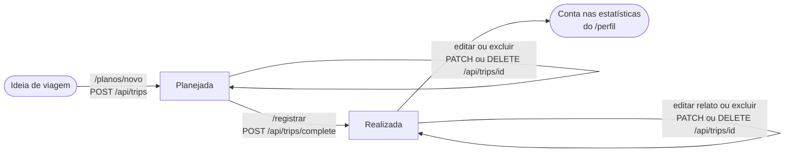
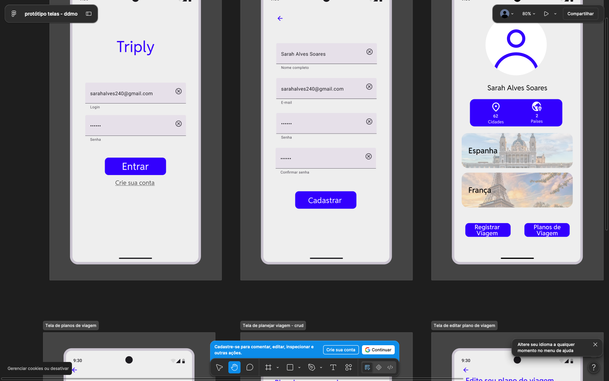
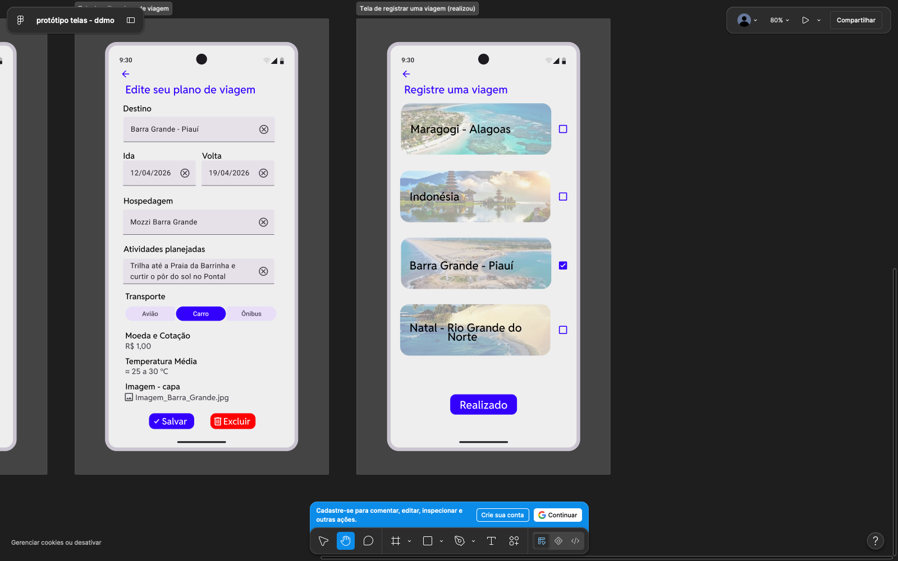

# Como o Triply funciona

Este documento apresenta o app: o problema que ele resolve, o ciclo de vida de uma viagem, as telas, as tecnologias, as pastas do código e como rodar tudo no seu computador.

## Resumo em 30 segundos

- **O que é:** um web app para **planejar viagens** e, depois de viajar, **registrar como foram**.
- **Ciclo de vida:** toda viagem nasce **planejada** e vira **realizada** quando a pessoa registra o relato. Só as realizadas entram nas estatísticas do perfil.
- **Telas:** 10 rotas (login, cadastro, perfil, detalhe, planos, novo plano, editar plano, registrar, `/sobre` e `/api-docs`). Cada uma chama uma parte pequena da API própria em `/api/*`.
- **Protótipo:** o Figma era só mobile. O web foi feito **desktop primeiro** e continua usável no celular.
- **Stack:** Next.js 16, React 19, TypeScript e Tailwind CSS v4, com o banco em memória na parte 1.

## 1. O que é o Triply e que problema resolve

Quem viaja costuma ter as informações espalhadas: o plano num papel, a cotação do dólar numa busca, a previsão do tempo em outro app, as lembranças na galeria. O Triply junta isso em um só lugar:

1. **Planejar:** a pessoa escolhe um destino (com autocomplete) e as datas. O app sugere **moeda e cotação, temperatura média e uma foto de capa**, buscadas em APIs externas.
2. **Registrar:** depois da viagem, ela marca o plano como realizado e conta como foi: nota, companhia, gastos e relato.
3. **Acompanhar:** o perfil mostra quantas **cidades** e **países** já foram visitados.

## 2. Ciclo de vida de uma viagem



Regras que o servidor garante (veja [`src/server/trips/service.ts`](../../src/server/trips/service.ts)):

- A viagem só muda de **planejada** para **realizada** pela rota `POST /api/trips/complete`, que aceita várias viagens de uma vez. Não existe caminho de volta.
- O **relato** (nota, companhia, gastos, texto) só pode ser gravado em viagem realizada. Em plano, a API responde erro de validação.
- Cada pessoa só enxerga as **próprias** viagens: o id de outra conta responde "não encontrada".

## 3. Tour pelas telas

O protótipo do Figma (só celular) serviu de base. Duas das quatro capturas guardadas no repositório:





As outras duas ficam em [`02-perfil-detalhe.png`](../figma/02-perfil-detalhe.png) e [`03-planos-planejar-editar.png`](../figma/03-planos-planejar-editar.png).

| Rota | O que a pessoa faz ali | Endpoints `/api` usados |
|---|---|---|
| `/login` | Entra com e-mail e senha. Se veio de outra página, volta para ela depois (`?next=`). | `POST /api/auth/login` |
| `/cadastro` | Cria a conta (nome, e-mail, senha e confirmação) e já entra. | `POST /api/auth/register` |
| `/perfil` | Vê nome, número de cidades e países e as viagens **realizadas**. Daqui vai para registrar ou planejar. | `GET /api/profile` · `GET /api/trips?status=realizada` |
| `/viagens/[id]` | Lê o detalhe de uma viagem realizada (hospedagem, cotação, gastos, relato), edita o relato ou exclui. | `GET /api/trips/{id}` · `PATCH /api/trips/{id}` · `DELETE /api/trips/{id}` |
| `/planos` | Vê os planos (viagens **planejadas**) e escolhe um para editar. | `GET /api/trips?status=planejada` |
| `/planos/novo` | Planeja uma viagem: digita o destino, escolhe a sugestão, define datas e vê o painel "Sobre o destino". | `GET /api/destinations/search` · `GET /api/destinations/insights` · `POST /api/trips` |
| `/planos/[id]` | Edita ou exclui um plano. O painel de destino funciona igual ao de "novo". | `GET /api/trips/{id}` · `PATCH /api/trips/{id}` · `DELETE /api/trips/{id}` · os dois de `destinations` |
| `/registrar` | Marca planos como realizados e responde "Como foi sua viagem?" passo a passo, um plano por vez. | `GET /api/trips?status=planejada` · `POST /api/trips/complete` |
| `/sobre` | Página **pública** com arquitetura, endpoints e APIs externas. Não chama a API. | nenhum |
| `/api-docs` | Página **pública** com a documentação interativa da API, com botão "Try it". | `GET /api/openapi.json` (e qualquer rota que se queira testar) |

Em todas as telas logadas (tudo, menos `/login`, `/cadastro`, `/sobre` e `/api-docs`), o layout chama `GET /api/auth/me` para mostrar o nome na barra, e o botão **Sair** chama `POST /api/auth/logout`. Quando a viagem tem capa enviada pela pessoa, a imagem vem de `GET /api/trips/{id}/cover`.

A explicação de **como** cada chamada acontece está em [03-conexao-front-back.md](03-conexao-front-back.md).

## 4. Do protótipo mobile para a web

O que foi **mantido** do Figma: a cor primária `#3300FF`, as fontes Lexend (títulos) e Roboto (texto), os campos do estilo Material 3 e o fluxo das telas.

O que **mudou** para funcionar no navegador:

| No protótipo (celular) | Na versão web |
|---|---|
| Uma coluna, tela de celular | **Desktop primeiro**: conteúdo centralizado (até 1152 px) e listas em grade de 1, 2 ou 3 colunas, conforme a largura. |
| Navegação só pelos botões da tela de perfil | **Barra no topo** com Meu perfil, Planos, Registrar, o nome e Sair. No celular os links vão para uma **barra inferior** com 3 abas. |
| Botão de criar plano flutuante | No celular continua o botão "+" flutuante. No desktop vira um botão "Nova viagem" no cabeçalho. |
| Login e cadastro em tela cheia | No desktop, o formulário fica numa coluna e um **painel de marca** ocupa a outra. |
| Formulário de plano em uma coluna | No desktop, o formulário e o painel "Sobre o destino" ficam **lado a lado**. |
| Telas sempre completas | Há estados de **carregamento** (esqueletos), **erro** (com "Tentar novamente") e **vazio** (com botão de ação). |

Também foram acrescentados: autocomplete de destino, painel com dados das APIs externas, avisos rápidos (toasts), foco visível, contraste de cor revisado, navegação por teclado e as páginas públicas `/sobre` e `/api-docs`.

## 5. Stack em linguagem simples

| Peça | O que é | Por que está aqui |
|---|---|---|
| **Next.js 16** (App Router) | Framework que organiza o projeto em pastas: cada pasta de `src/app` vira uma URL. | Entrega as **páginas** e a **API** no mesmo projeto e no mesmo deploy. |
| **React 19** | Biblioteca para montar a tela com componentes reutilizáveis. | Cada card, botão e formulário é um componente. |
| **TypeScript** | JavaScript com tipos: o editor avisa quando um dado tem o formato errado. | Front e back usam os mesmos tipos (`src/types/api.ts`). |
| **Tailwind CSS v4** | Estilo por classes pequenas direto no HTML (`p-4`, `text-primary`). | Agilidade e consistência; as cores do design ficam em [`globals.css`](../../src/app/globals.css). |
| **lucide-react**, **sonner**, **date-fns** | Ícones, avisos rápidos (toasts) e formatação de datas. | Evitam reinventar o que já existe. |
| **zod** | Biblioteca que confere se um dado tem o formato esperado, em tempo de execução. | Valida tudo o que chega na API. |
| **jose** e **bcryptjs** | Assinatura do token de sessão (JWT) e hash de senha. | Login seguro: a senha nunca é guardada em texto. |
| **Banco em memória** (parte 1) | Os dados ficam em variáveis no servidor e voltam ao estado inicial quando ele reinicia. | Atende a parte 1 sem instalar banco nenhum. |
| **PostgreSQL + Drizzle** (parte 2) | Banco relacional e um **ORM**, biblioteca que traduz TypeScript em SQL. | Já está no código; liga com `DB_DRIVER=postgres`. |
| **OpenAPI 3.1** + Scalar | Padrão que descreve uma API e a tela interativa que lê essa descrição. | Gera a documentação de `/api-docs`. |
| **Vercel** | Plataforma que hospeda o app. | Atende o requisito de hospedagem. |

## 6. Estrutura de pastas

```text
src/
├─ app/                 # páginas (cada pasta vira uma URL) e a API
│  ├─ (auth)/           #   /login e /cadastro
│  ├─ (app)/            #   /perfil, /viagens, /planos e /registrar (exigem login)
│  ├─ sobre/ api-docs/  #   páginas públicas
│  └─ api/              #   Route Handlers: a API REST (src/app/api/**/route.ts)
├─ components/          # telas e peças de interface (ProfileView, TripForm, TripCard...)
│  └─ ui/               #   componentes básicos do design system (Button, TextField, Dialog...)
├─ hooks/               # lógica de tela reutilizável (useAsyncData, useDebouncedValue...)
├─ lib/                 # api-client.ts (único jeito de chamar a API), formatação de datas e valores
├─ server/              # só roda no servidor
│  ├─ http/             #   wrapper das rotas, erros padronizados, validação
│  ├─ auth/ users/ trips/   #   regras de negócio, schemas zod
│  ├─ destinations/ external/   #   junta e chama as APIs externas
│  └─ openapi/          #   especificação da API
├─ db/                  # camada de dados: repositórios + implementação em memória e Postgres
├─ types/api.ts         # contrato de tipos compartilhado entre front e back
└─ proxy.ts             # protege as páginas (redireciona para /login)
docs/                   # SPEC, API, QA, figma e este guia
```

## 7. Como rodar localmente

Precisa do **Node.js 20.9 ou mais novo**. Na parte 1 **não é preciso instalar banco**.

```bash
npm install
cp .env.example .env.local   # depois edite o arquivo e defina JWT_SECRET
npm run dev                  # http://localhost:3000
```

No `.env.local`, a única variável obrigatória é `JWT_SECRET`: uma string aleatória com **32 caracteres ou mais**, usada para assinar a sessão. Gere uma com `openssl rand -base64 48` e **nunca a coloque no Git**. `DB_DRIVER` pode ficar de fora: o padrão é `memory`. As APIs externas não pedem chave.

Ao subir, o terminal mostra `[db] banco em memória`. Reiniciar o servidor volta tudo ao estado inicial.

### Contas de demonstração

Todas com a senha **`triply123`**. Cada conta tem a **sua cópia** das 7 viagens (2 realizadas: Espanha e França; 5 planejadas), então o que uma pessoa edita não aparece para as outras.

| Nome | E-mail |
|---|---|
| Enzo Rodrigues | `enzo@triply.app` |
| Tabata | `tabata@triply.app` |
| Pietra | `pietra@triply.app` |
| Vitor | `vitor@triply.app` |
| Wesley | `wesley@triply.app` |
| Adilson | `adilson@triply.app` |

Em produção: [triply-kappa-sepia.vercel.app](https://triply-kappa-sepia.vercel.app). Lá o banco em memória é **por instância** do servidor, então contas novas podem ser "esquecidas". Para apresentar, use as contas acima.

## Para a apresentação

- **O problema:** "plano, cotação, clima e lembranças ficam espalhados; o Triply junta tudo". Conte o ciclo **planejada → realizada** com o diagrama da seção 2.
- **O protótipo virou web:** mostre `docs/figma/` ao lado do app. Aponte o que mudou: navbar no desktop, barra inferior no celular, formulário em duas colunas.
- **Uma tela, uma API:** cada rota da tabela da seção 3 usa poucos endpoints. É o que liga este guia ao `02-apis.md` e ao `03-conexao-front-back.md`.
- **Stack com motivo:** Next.js entrega páginas e API juntas, TypeScript garante o contrato, zod valida em tempo de execução, o banco em memória atende a parte 1 e o PostgreSQL já está pronto para a parte 2.
- **Ao vivo:** entre como `enzo@triply.app`, abra `/perfil`, encolha a janela até o layout de celular (barra inferior), vá em `/planos/novo` e digite "Bali". Depois abra `/sobre` e `/api-docs`.
