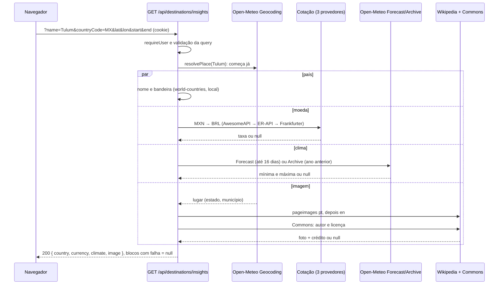

# Quais APIs o Triply usa

Este documento explica as duas famílias de API do projeto: a **API própria**, que o front-end consome, e as **APIs externas**, que o servidor consulta para buscar destinos, clima, cotação e fotos.

## Resumo em 30 segundos

- Uma **API** é um conjunto de endereços (URLs) pelos quais um programa conversa com outro. O Triply tem a sua, **REST**, em `/api/*` (15 operações), e consome APIs de terceiros.
- **5 grupos de APIs externas, nenhum exige chave:** Open-Meteo Geocoding (busca de destinos), Open-Meteo Forecast/Archive (clima), cotação (AwesomeAPI → ExchangeRate-API → Frankfurter), Wikipedia/Commons (foto e crédito) e flagcdn (bandeira).
- **Só o servidor chama as APIs externas.** O navegador fala apenas com `/api/*`; só os *arquivos* de imagem (foto, bandeira) ele baixa direto pela URL.
- **Falha não derruba nada:** cada bloco do `insights` falha sozinho e vira `null`. Há timeout de 5 s, cache em 2 camadas e pausa automática quando um serviço responde `429`.
- **Países vêm de um dataset local** (`world-countries`), porque a REST Countries v3.1 foi desativada.

---

## Parte A — API própria (REST)

**REST** é um estilo de API sobre HTTP: cada coisa (viagem, usuário) tem uma URL e o **método** HTTP diz a ação: `GET` lê, `POST` cria, `PATCH` altera, `DELETE` apaga. As respostas são **JSON** (texto estruturado, como `{"destination": "Paris"}`) e o **status HTTP** (200, 404...) diz se deu certo.

| Grupo | Rota | Para que serve |
|---|---|---|
| Auth | `POST /api/auth/register` | Cria a conta e já abre a sessão |
| Auth | `POST /api/auth/login` · `POST /api/auth/logout` | Entra · sai (apaga o cookie) |
| Auth | `GET /api/auth/me` | Diz quem está logado |
| Perfil | `GET /api/profile` | Usuário + estatísticas (cidades, países, viagens) |
| Viagens | `GET·POST /api/trips` | Lista (com `?status=`) · cria uma viagem |
| Viagens | `GET·PATCH·DELETE /api/trips/{id}` | Lê · altera · apaga uma viagem |
| Viagens | `POST /api/trips/complete` | Marca várias como realizadas, com o relato de cada uma |
| Viagens | `GET /api/trips/{id}/cover` | Entrega a imagem de capa enviada por upload |
| Destinos | `GET /api/destinations/search?q=` | Autocomplete de destinos (usa o geocoding) |
| Destinos | `GET /api/destinations/insights` | País, moeda/cotação, clima e foto de um destino |
| Docs | `GET /api/openapi.json` · página `/api-docs` | Especificação da API · tela para testá-la |

**Convenções** (o detalhe está em [03-conexao-front-back.md](03-conexao-front-back.md)):
- **JSON nos dois sentidos.** Escritas exigem `Content-Type: application/json`.
- **Status HTTP com significado:** `400` dado inválido, `401` sem sessão, `404` não achou (ou é de outro usuário), `409` e-mail já usado, `429` muitas tentativas de login, `502` serviço externo fora do ar, `500` erro inesperado.
- **Todo erro tem o mesmo formato**, com mensagem em pt-BR pronta para a tela:
  ```json
  { "error": { "code": "NOT_FOUND", "message": "Viagem não encontrada." } }
  ```
- **Sessão por cookie.** O login devolve o cookie `triply_session` (um JWT, "crachá" assinado pelo servidor), `httpOnly` e válido por 7 dias. O navegador o reenvia sozinho; o JavaScript da página não o lê. Veja [`cookie.ts`](../../src/server/auth/cookie.ts).
- **Rotas protegidas** usam `requireUser()` ([`session.ts`](../../src/server/auth/session.ts)). Exceções públicas: cadastro, login, logout, `/api/openapi.json` e `/api-docs`.

**Para o detalhe e para testar:** referência completa em [`docs/API.md`](../API.md); documentação interativa em [`/api-docs`](https://triply-kappa-sepia.vercel.app/api-docs) (execute o login e depois qualquer rota).

---

## Parte B — APIs externas

Todas vivem em [`src/server/external/`](../../src/server/external/) e são orquestradas por [`insights.ts`](../../src/server/destinations/insights.ts). Os TTLs abaixo (*time to live*: por quanto tempo uma resposta guardada continua valendo) são os do código; a Parte C explica as duas camadas de cache.

| API | Para que serve | Memória | Data Cache |
|---|---|---|---|
| Open-Meteo Geocoding | Buscar destinos | 1 dia | 7 dias |
| Open-Meteo Forecast / Archive | Temperatura | 6 h | 3 h / 30 dias |
| AwesomeAPI → ExchangeRate-API → Frankfurter | Cotação em reais | 1 h | 1 h |
| Wikipedia + Commons | Foto, autor e licença | 1 dia | 7 dias / 30 dias |
| flagcdn | Bandeira | — | — |

### B.1 Open-Meteo Geocoding — buscar destinos

[`geocoding.ts`](../../src/server/external/geocoding.ts). *Geocoding* é transformar um nome ("Tulum") em lugar com coordenadas.
- **Serve para:** o autocomplete do "Novo plano" e para descobrir estado, país e coordenadas de um destino.
- **Chamada:** `GET https://geocoding-api.open-meteo.com/v1/search?name=Tulum&count=40&language=pt&format=json`. Pedimos 40 resultados e devolvemos até 8.
- **Aproveitamos:** `id`, `name`, `latitude`, `longitude`, `country_code`, `country`, `admin1` (estado), `admin2` (município), `population` e `feature_code` (tipo de lugar, no padrão GeoNames: `PPLA2` sede de município, `PCLI` país...).
- **Se falhar:** é o único caso que vira erro, `502 EXTERNAL_API_ERROR`; o autocomplete mostra "Não foi possível buscar destinos agora".
- **Licença:** dados abertos do Open-Meteo, uso gratuito não comercial; créditos na página `/sobre`.

```json
{ "id": 3515040, "name": "Tulum", "latitude": 20.21173, "longitude": -87.46325, "feature_code": "PPLA2",
  "country_code": "MX", "country": "México", "admin1": "Quintana Roo", "admin2": "Tulum", "population": 18233 }
```

**Nosso ranking.** A ordem da API põe homônimos obscuros na frente (há vários "Gramado"). Por isso reordenamos por pontos:
- **Relevância do nome:** igual ao digitado (5), começa com ele no meio de uma palavra (3: "madri" → "Madrid"), palavra inteira ("Bangkok Noi", 1,5), contém (1), nome alternativo (0,5: "Bangkok" → "Banguecoque").
- **Importância:** `log10(população)` mais um bônus pelo tipo (país 3, capital 2,5, sede 1,5, ilha 1,5...) e um bônus para a sede do próprio município.
- **Filtro:** só onde se viaja (cidades, ilhas, países, estados, regiões e resorts); aeroportos, montes e parques saem. Resultados com menos de 20% da melhor nota são cortados e rótulos repetidos são fundidos.
- **Aliases:** "Nova York" e "New York" também buscam `nyc` e juntam os resultados, porque a API só acha um município do Maranhão. Rótulo final: `Natal - Rio Grande do Norte` (Brasil), `Tulum, México` (exterior).

### B.2 Open-Meteo Forecast × Archive — temperatura

[`weather.ts`](../../src/server/external/weather.ts). Mesma família, dois endpoints, mesmos parâmetros: `latitude`, `longitude`, `daily=temperature_2m_max,temperature_2m_min`, `timezone=auto`, `start_date`, `end_date`.
- **Forecast** (`api.open-meteo.com/v1/forecast`): **previsão**, alcança no máximo **16 dias** à frente.
- **Archive** (`archive-api.open-meteo.com/v1/archive`): **histórico** de dias que já passaram.

| Período da viagem | Chamada | `source` |
|---|---|---|
| Sem datas | Forecast dos próximos 7 dias | `previsao` |
| Começa hoje ou depois **e** termina em até 16 dias | Forecast nas datas exatas | `previsao` |
| Terminou há mais de 7 dias | Archive nas datas exatas | `historico` |
| Mais distante (ou recente demais para o Archive) | Archive nas **mesmas datas do ano anterior** (recua até achar um ano completo, no máximo 5) | `historico` |

Se a previsão falhar, cai no histórico do ano anterior. Períodos acima de 31 dias são cortados. **Aproveitamos** a média das mínimas e das máximas (dias sem dado ficam de fora), com 1 casa decimal e o texto `≈ 24 a 32 °C`.
- **Se falhar:** `climate: null`; a tela mostra "Indisponível" (ou a temperatura salva no plano). **Licença:** CC BY 4.0, citada na tela ("Open-Meteo (CC BY 4.0)").

```json
{ "daily": { "time": ["2026-10-12", "2026-10-13"], "temperature_2m_max": [31.7, 31.9], "temperature_2m_min": [24.9, 24.8] } }
```

### B.3 Cotação — cadeia de três provedores

[`exchange.ts`](../../src/server/external/exchange.ts). Cada país tem uma moeda (vinda do dataset local) e queremos "1 MXN = R$ ?". Tentamos em ordem e **paramos no primeiro que responde**:

| # | Chamada | Campo usado |
|---|---|---|
| 1 | `economia.awesomeapi.com.br/json/last/MXN-BRL` | `MXNBRL.bid` |
| 2 | `open.er-api.com/v6/latest/MXN` | `rates.BRL` |
| 3 | `api.frankfurter.dev/v1/latest?base=MXN&symbols=BRL` | `rates.BRL` |

- **Por que três?** Nenhuma cobre tudo. A AwesomeAPI não tem rupia indonésia (`IDR-BRL` responde `404 CoinNotExists`); a ExchangeRate-API cobre. A Frankfurter (dados do Banco Central Europeu) é a última rede de segurança.
- **Regras:** `BRL` não consulta ninguém (R$ 1,00). A taxa é arredondada a 6 casas, como a coluna do banco. Guardamos nome, símbolo, data da cotação e **provedor** (`source`, `sourceUrl`), exibidos na tela.
- **Se todas falharem:** `currency: null`. O plano é salvo mesmo assim, só sem cotação.
- **Atribuição:** a ExchangeRate-API exige link visível para o serviço; a Frankfurter é gratuita e de código aberto.

```json
{ "amount": 1.0, "base": "IDR", "date": "2026-10-09", "rates": { "BRL": 0.00028 } }
```

### B.4 Wikipedia (MediaWiki) + Commons — foto, autor e licença

[`image.ts`](../../src/server/external/image.ts). *MediaWiki* é o software da Wikipédia; o *Commons* é o acervo de imagens livres dela.
- **Foto:** `GET https://{pt|en}.wikipedia.org/w/api.php?action=query&prop=pageimages&piprop=thumbnail|original|name&pithumbsize=1280&redirects=1&titles=A|B|C&format=json&formatversion=2`. Tentamos vários títulos de uma vez, **primeiro em português, depois em inglês**.
- **Ordem dos títulos:** `Cidade (Estado)`, `Cidade`, município e país. O sufixo evita erros: "Natal" sozinho é a festa, "Natal (Rio Grande do Norte)" é a cidade. Imagens SVG (mapas, brasões) são descartadas.
- **País → foto da capital.** Quando o destino é um país ("México", "Indonésia"), o artigo dele só tem bandeira e mapa (SVG). Então tentamos o país e, em seguida, a **capital** (México → Cidade do México).
- **Crédito:** `GET https://commons.wikimedia.org/w/api.php?action=query&titles=File:<arquivo>&prop=imageinfo&iiprop=extmetadata|url` devolve `Artist`, `LicenseShortName` e `descriptionurl`. A tela mostra "Foto: autor · licença" com link.
- **Se falhar ou não achar foto:** `image: null` ("Indisponível") e a capa fica como um gradiente.
- **Licença:** cada imagem tem a sua (CC BY, CC BY-SA, domínio público...). Por isso o autor e a licença **sempre** vão junto da foto.

```json
{ "Artist": "Carlos Delgado", "LicenseShortName": "CC BY-SA 3.0",
  "descriptionurl": "https://commons.wikimedia.org/wiki/File:Plaza_Mayor_de_Madrid_-_01.jpg" }
```

### B.5 flagcdn — bandeira

- **Serve para:** a bandeira ao lado do país no painel "Sobre o destino".
- **O servidor não chama o flagcdn:** só monta a URL `https://flagcdn.com/w320/{cca2 em minúsculas}.png` (ex.: `mx`) a partir do código do país, e o **navegador** baixa a imagem. Não há aproveitamento de resposta nem TTL nosso.
- **Se falhar:** a bandeira não aparece; nome e demais dados continuam. **Licença:** serviço gratuito, sem chave; os créditos estão em `/sobre`.

### B.6 Por que o REST Countries saiu

[`countries.ts`](../../src/server/external/countries.ts) precisa de nome do país em português, moeda e capital. A ideia inicial era a REST Countries, mas a v3.1 foi **desativada** (hoje responde "This API version has been deprecated") e a v5 exige **chave de API**, um problema para um repositório público. Adotamos o pacote **`world-countries`**: não é uma API, é um **dataset** (arquivo de dados) dentro do próprio projeto. Vantagens: zero chamada de rede, nunca fica fora do ar e é mais rápido. Custo: só atualiza ao subir a versão do pacote, o que para países raramente importa.

### B.7 O User-Agent identificado

Todas as chamadas levam `User-Agent: Triply/1.0 (projeto academico DSW3)` ([`http.ts`](../../src/server/external/http.ts)). O *User-Agent* é o cabeçalho que diz quem está pedindo. A política da Wikimedia pede um identificador descritivo, e clientes genéricos (`curl`, `python-requests`) costumam ser bloqueados. Não pusemos e-mail pessoal nele.

---

## Parte C — Resiliência

APIs de terceiros caem, atrasam e limitam acessos. O princípio: **uma falha externa nunca derruba o Triply.**

- **Timeout:** cada chamada espera no máximo **5 s** (`AbortSignal.timeout`). Passou disso, vira `null`. Cada bloco do `insights` tem prazo de 10 s, e salvar uma viagem gasta no máximo 8 s enriquecendo; depois, salva o que tiver.
- **Cache em 2 camadas** ([`cache.ts`](../../src/server/external/cache.ts)):
  1. **Memória** da instância, com os TTLs da tabela acima. Junta chamadas simultâneas iguais numa só. Falhas ficam guardadas só 30 s.
  2. **Data Cache do Next** (`fetch` com `next.revalidate`): **persistente**, compartilhado entre instâncias e deploys. **Só respostas 2xx entram**: erro, 429 e timeout nunca são guardados.
  Efeito: ensaiar a demonstração uma vez deixa tudo "aquecido".
- **Cada bloco falha sozinho:** `insights` roda `país`, `moeda`, `clima` e `imagem` em paralelo (`Promise.all`); o que falha vira `null` e a rota responde **200** do mesmo jeito. A exceção é a busca (`502`), pois sem ela não há o que mostrar.
- **429 (muitas requisições):** o serviço respondeu "calma". O servidor lê `Retry-After` e **para de chamar aquele host** por esse tempo (padrão 30 s, no máximo 60 s), devolvendo `null` na hora.
- **Por que tudo no servidor, nunca no navegador?** (1) o cache é compartilhado: uma consulta serve todos os usuários; (2) o servidor se identifica com o `User-Agent` e trata falhas num só lugar; (3) só quem está logado gasta a nossa cota, e a entrada é validada; (4) ao criar uma viagem, o servidor já completa moeda, clima e capa antes de salvar. **Exceção consciente:** as *imagens* (foto, bandeira) o navegador baixa direto. O otimizador de imagens do Next as buscaria no servidor, e a Wikimedia devolve `429` para esse acesso ([`CoverImage.tsx`](../../src/components/CoverImage.tsx)).



## Para a apresentação

- **Duas frases-chave:** "a API própria é o contrato entre o front e o back" e "as APIs externas são dependências que podem falhar, então o servidor as isola".
- **Conte a história do REST Countries:** a API que usávamos foi desativada e a nova pede chave. A solução (dataset local) é uma lição sobre **risco de depender de terceiros**.
- **Ao vivo no app:** em "Novo plano" (`/planos/novo`), digite "Madri" (o ranking traz Madrid) e escolha **Tulum**. No painel "Sobre o destino", mostre bandeira, cotação, clima e foto, cada um com a **fonte**, e o crédito da foto (autor · licença).
- **Ao vivo no `/api-docs`:** execute o login e depois `GET /api/destinations/insights?name=Tulum&countryCode=MX`. Mostre os 4 blocos e, no `climate`, o campo `source` (`previsao` ou `historico`).
- **Se perguntarem "e se a API cair?":** cada bloco vira `null` ("Indisponível") e o plano continua salvando. A página `/sobre` lista todas as APIs com endpoint e cache.
