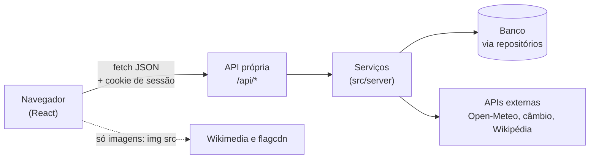
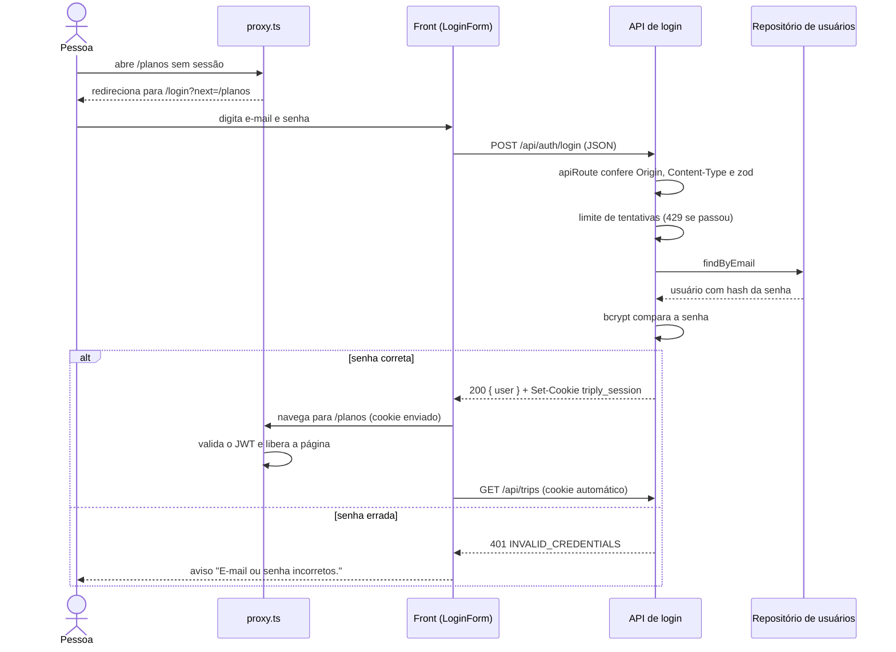
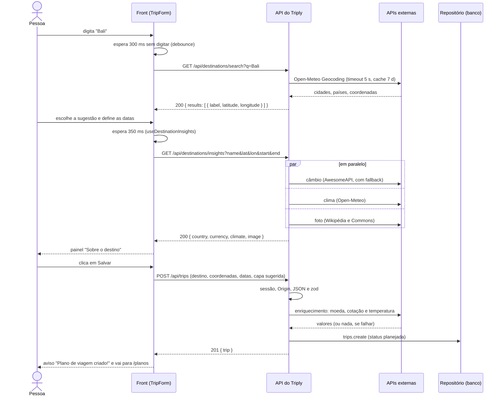

# Como o front conversa com o back

Este documento explica, de ponta a ponta, como uma tela do Triply pede dados ao servidor: o cliente HTTP do front, a API em `/api/*`, o login com cookie e dois fluxos completos.

## Resumo em 30 segundos

- O front (React, no navegador) só fala com a **API própria** em `/api/*`, por `fetch` e JSON. Nunca chama APIs externas nem o banco.
- Front e back usam os **mesmos tipos TypeScript**, definidos em [`src/types/api.ts`](../../src/types/api.ts).
- No front, um único arquivo monta as requisições e traduz os erros: [`src/lib/api-client.ts`](../../src/lib/api-client.ts). Hooks cuidam de carregamento, erro e estado vazio.
- No back, cada rota passa pelo wrapper `apiRoute`: valida com **zod**, confere a sessão e devolve erros sempre no formato `{ error: { code, message, fields } }`.
- O login grava um **JWT** em um cookie `httpOnly`. O navegador reenvia o cookie sozinho, e o servidor o valida em cada rota.

## 1. Visão geral: o front só conhece `/api/*`



Por que não chamar as APIs externas direto do navegador?

| Motivo | Explicação |
|---|---|
| **Segurança** | O segredo do JWT e o acesso ao banco existem só no servidor. É também o servidor que decide quem pode ver o quê: toda consulta de viagem filtra pelo usuário da sessão. |
| **Cache** | O servidor guarda as respostas externas por tempo definido (por exemplo, geocodificação por 7 dias) e **todos os usuários** aproveitam. Se cada navegador chamasse direto, o limite gratuito de cada serviço acabaria rápido. |
| **Chaves** | Hoje nenhuma API externa exige chave, mas, se uma exigisse, ela ficaria no servidor. Código que roda no navegador é visível para qualquer pessoa. |
| **CORS** | É a regra do navegador que impede um site de ler respostas de **outro domínio**, a menos que o outro lado permita. Como o front chama a **própria origem** (`/api/...`), não há CORS, e o cookie vai junto. |
| **Padronização** | O servidor traduz formatos diferentes de cada provedor para um só (`DestinationInsightsResponse`) e trata falhas: um bloco que falha vira `null`. |

A única exceção são **arquivos de imagem**: as fotos da Wikimedia e as bandeiras do flagcdn são carregadas pelo navegador em ``, usando a URL que a API devolveu. Isso não é uma chamada de API.

## 2. O contrato compartilhado: `src/types/api.ts`

Um único arquivo descreve o formato de tudo o que cruza a fronteira: `Trip`, `User`, `TripInput`, `ProfileResponse`, `DestinationInsightsResponse`, `ApiError`, os códigos de erro etc. Os dois lados importam dele:

```ts
// back: src/app/api/trips/route.ts
return created<TripResponse>({ trip: serializeTrip(row) });

// front: src/lib/api-client.ts
export const createTrip = (input: TripInput) =>
  request<TripResponse>("POST", "/api/trips", { body: input });
```

Se alguém mudar um campo em `TripResponse`, o TypeScript acusa erro nos dois lados **antes de rodar**. Tipos, porém, **somem na execução**: por isso o servidor também valida o que recebe com zod (seção 4). A especificação OpenAPI é conferida contra as rotas e os schemas reais pelo script `npm run docs:check`.

## 3. Lado do front

### 3.1 O cliente HTTP: `api-client.ts`

Toda tela chama funções como `login()`, `listTrips()` ou `createTrip()`. Elas usam uma função interna, `request`, que:

- chama **só caminhos da própria origem** (`/api/...`) com `fetch`;
- envia `credentials: "same-origin"`, o que faz o navegador incluir o cookie de sessão;
- usa `cache: "no-store"`, para os dados do usuário nunca ficarem velhos (só as buscas de destino permitem cache HTTP, mas quem guarda o cache de verdade é o servidor);
- manda `Content-Type: application/json` apenas quando há corpo e serializa com `JSON.stringify`;
- monta a query string ignorando valores vazios (`buildUrl`);
- devolve `undefined` em respostas `204 No Content` (logout e exclusão).

**Erros** viram uma única classe, `ApiClientError`, com `status`, `code`, `message` e `fields` (erros por campo). Se o servidor não responde, o código é `NETWORK_ERROR`, com a mensagem "Sem conexão com o servidor…". As telas usam `getErrorMessage(error)` e `getFieldErrors(error)`:

| Erro | O que a tela faz |
|---|---|
| `VALIDATION_ERROR` com `fields` | Mostra cada mensagem **embaixo do campo** e um aviso "Revise os campos destacados". |
| `INVALID_CREDENTIALS`, `TOO_MANY_REQUESTS`, `INTERNAL_ERROR`, `NETWORK_ERROR` | Mostram `message` (já em português) num aviso rápido (toast) ou, nas listas, no bloco de erro. |
| `EMAIL_IN_USE` | Marca o campo e-mail do cadastro (a API manda `fields.email`). |
| `EXTERNAL_API_ERROR` | O autocomplete mostra "Não foi possível buscar destinos agora". |
| `UNAUTHORIZED` (401) | Não é mostrado como erro: o cliente **sai e vai para o login** (veja abaixo). |

**401 → logout.** Quando a sessão é inválida, `redirectToLogin()` primeiro chama `POST /api/auth/logout` para **apagar o cookie** e depois navega para `/login?next=<página atual>`. Sem apagar o cookie, o `proxy.ts` (que só confere a assinatura) mandaria a pessoa de volta a `/perfil`, e a página entraria em loop. A navegação usa `window.location.replace` (`hardNavigate`, em [`src/lib/navigation.ts`](../../src/lib/navigation.ts)), que recarrega tudo e não deixa a página autenticada no botão "Voltar".

### 3.2 Hooks

| Hook | O que faz | Onde aparece |
|---|---|---|
| [`useAsyncData(fetcher)`](../../src/hooks/useAsyncData.ts) | Executa a busca e devolve `{ data, error, loading, reload, mutate }`. Cancela a chamada ao sair da tela (`AbortController`) e, numa recarga, **mantém os dados antigos** em vez de piscar. | Perfil, planos, detalhe, registrar |
| [`useCurrentUser()`](../../src/hooks/useCurrentUser.ts) e `UserProvider` | O layout logado chama `GET /api/auth/me` **uma vez** e compartilha o usuário por contexto. | Navbar (nome) |
| [`useDebouncedValue(valor, ms)`](../../src/hooks/useDebouncedValue.ts) | Devolve o valor só depois de ficar `ms` sem mudar (*debounce*: espera a pessoa parar de digitar). | Autocomplete (300 ms) |
| [`useDestinationInsights(params)`](../../src/hooks/useDestinationInsights.ts) | Espera 350 ms, chama `GET /api/destinations/insights` e devolve `idle`, `loading`, `ready` ou `error`. Sem destino escolhido, fica ocioso. | Painel "Sobre o destino" |
| [`useReloadOnPageRestore()`](../../src/hooks/useReloadOnPageRestore.ts) | Se o navegador restaurar a página do cache de histórico (*bfcache*), recarrega. Assim o "Voltar" depois do logout não mostra dados antigos. | Layout logado |

### 3.3 Estados de carregamento, erro e vazio

Toda lista trata os três casos (veja `ProfileView` e `PlansView`):

- **Carregando:** esqueletos cinzas (`TripCardSkeleton`), com texto para leitores de tela.
- **Erro:** `ErrorState` com a mensagem da API e o botão "Tentar novamente", que chama `reload()`.
- **Vazio:** `EmptyState` com explicação e botão de ação ("Planejar primeira viagem").
- **Parcial:** no painel de destino, cada bloco que veio `null` mostra "Indisponível" e os outros continuam.

## 4. Lado do back

### 4.1 Route Handlers e o wrapper `apiRoute`

No Next.js, um arquivo `route.ts` dentro de `src/app/api/` vira uma URL, e as funções exportadas (`GET`, `POST`...) atendem cada método. São 15 operações em 12 arquivos, como [`src/app/api/trips/route.ts`](../../src/app/api/trips/route.ts):

```ts
export const POST = apiRoute(async (request) => {
  const user = await requireUser();                        // 1. quem é?
  const input = await parseBody(request, tripInputSchema); // 2. JSON válido?
  const row = await createTrip(user.id, input);            // 3. regra de negócio
  return created<TripResponse>({ trip: serializeTrip(row) }); // 4. 201 + JSON
});
```

[`apiRoute`](../../src/server/http/route.ts) envolve cada handler e faz duas coisas: (1) nas escritas (`POST`, `PUT`, `PATCH`, `DELETE`) confere o `Origin`, e (2) captura **qualquer exceção** e a transforma em um erro padronizado. Erro inesperado vira `500 INTERNAL_ERROR` com mensagem genérica; o detalhe só vai para o log. Nunca vaza stack trace nem mensagem do banco.

### 4.2 Validação com zod

[zod](https://zod.dev) descreve o formato esperado e confere os dados em tempo de execução. Os schemas ficam em `src/server/*/schemas.ts`, e `parseBody`/`parseWith` os aplicam. Exemplos de regras: e-mail válido, senha de 6 a 72 bytes, datas `AAAA-MM-DD` que existam no calendário, volta não anterior à ida. As mensagens saem em português (`z.config(z.locales.ptBR())`).

### 4.3 Formato de erro e status HTTP

Todo erro tem o mesmo corpo, definido em `ApiError`:

```json
{ "error": { "code": "VALIDATION_ERROR", "message": "Dados inválidos. Revise os campos informados.",
             "fields": { "endDate": "A volta deve ser no mesmo dia ou depois da ida." } } }
```

| Status | `code` | Quando |
|---|---|---|
| 400 | `VALIDATION_ERROR` | Corpo ou query inválidos, JSON malformado, corpo grande demais (limite de 4 MB) ou sem `Content-Type: application/json`. |
| 401 | `UNAUTHORIZED` | Sem sessão, sessão inválida/expirada ou usuário que não existe mais (a resposta também apaga o cookie). |
| 401 | `INVALID_CREDENTIALS` | E-mail ou senha errados. |
| 403 | `FORBIDDEN` | `Origin` diferente do host da aplicação. |
| 404 | `NOT_FOUND` | Recurso inexistente **ou de outro usuário**. |
| 409 | `EMAIL_IN_USE` | Cadastro com e-mail já usado. |
| 429 | `TOO_MANY_REQUESTS` | Muitas tentativas de login (traz o cabeçalho `Retry-After`). |
| 502 | `EXTERNAL_API_ERROR` | Só a busca de destinos, quando o geocoding está fora do ar. |
| 500 | `INTERNAL_ERROR` | Erro inesperado. |

As respostas JSON com dados do usuário levam `Cache-Control: private, no-store`: não ficam em cache de navegador nem de CDN. (Exceções: a especificação OpenAPI, que é pública, e a capa enviada, que usa cache privado.)

### 4.4 Proteções nas escritas

- **`Content-Type: application/json` obrigatório** ([`readJson`](../../src/server/http/validation.ts)). Um formulário HTML comum não consegue enviar esse tipo entre sites, o que fecha a porta do CSRF "simples" (*Cross-Site Request Forgery*: outro site fazendo o navegador da vítima enviar uma requisição).
- **Conferência do `Origin`**: se o navegador manda o cabeçalho, ele precisa ser o próprio host. Sem `Origin` (curl, testes), segue normalmente.
- **Cookie `SameSite=Lax`**: o navegador não envia o cookie em requisições de escrita vindas de outros sites.

## 5. Autenticação

**JWT** (*JSON Web Token*) é um texto com três partes: um cabeçalho, os dados (aqui, o id do usuário e a validade) e uma **assinatura** feita com um segredo que só o servidor conhece (HS256, biblioteca `jose`). Se alguém alterar o conteúdo, a assinatura deixa de bater.

- **Login** ([`/api/auth/login`](../../src/app/api/auth/login/route.ts)): confere o e-mail e a senha (hash **bcrypt**) e responde com o usuário e um `Set-Cookie` com o JWT.
- **O cookie** `triply_session` é `httpOnly` (o JavaScript da página não consegue lê-lo, então um script malicioso não o rouba), `SameSite=Lax`, `Secure` em produção (só trafega por HTTPS) e dura **7 dias**. Veja [`cookie.ts`](../../src/server/auth/cookie.ts) e [`token.ts`](../../src/server/auth/token.ts).
- **O front nunca vê o token.** O navegador envia o cookie sozinho em cada `fetch`; por isso o `api-client` usa `credentials: "same-origin"`.
- **Em cada rota protegida**, [`requireUser()`](../../src/server/auth/session.ts) lê o cookie, valida a assinatura e a validade e busca o usuário no repositório. Se algo falhar, responde `401` e apaga o cookie.
- **O `proxy.ts`** ([`src/proxy.ts`](../../src/proxy.ts)) protege as **páginas**: sem sessão válida, `/perfil`, `/viagens`, `/planos` e `/registrar` redirecionam para `/login?next=<caminho>`. Quem já está logado e abre `/login` ou `/cadastro` vai para `/perfil`. O `?next=` passa por [`safeNextPath`](../../src/server/auth/next-path.ts), que só aceita caminhos internos (nunca `//site.com` nem URL absoluta), evitando *open redirect*.
- **Duas camadas, papéis diferentes:** o proxy só melhora a experiência (nem mostra a página sem login). A **proteção de verdade** é a API, que checa a sessão por conta própria.
- **Limite de tentativas** ([`login-limit.ts`](../../src/server/auth/login-limit.ts)): ao chegar a 10 falhas em 15 minutos para o mesmo e-mail e IP (ou 30 para o mesmo IP, ou 30 para o mesmo e-mail), as próximas tentativas respondem `429` com `Retry-After`. E-mail e IP são guardados só como HMAC (um hash com chave). Na memória o contador vale por instância; no PostgreSQL vale para todas.

## 6. Dois fluxos completos

### 6.1 Login



### 6.2 Criar um plano: autocomplete, insights e salvar



O que vale explicar neste fluxo:

- **Cada bloco do `insights` falha sozinho** e vira `null`. A rota responde `200` mesmo com uma API fora do ar. Só a busca de destinos devolve `502`, porque sem ela não há o que mostrar.
- **O front não envia moeda nem temperatura**; só o destino, as coordenadas, as datas, o texto e a capa. Quem completa é o **enriquecimento automático** ([`enrich.ts`](../../src/server/trips/enrich.ts)): se o destino tem coordenadas ou país, o servidor preenche **só o que veio vazio** (valores enviados pelo cliente sempre vencem). Como o `insights` acabou de aquecer o cache, o passo costuma ser rápido.
- **Salvar nunca depende de API externa:** o enriquecimento tem um orçamento de 8 s, e qualquer falha ou estouro de prazo apenas deixa o campo vazio.
- **Capa:** o front manda a URL sugerida, uma imagem enviada pela pessoa (já redimensionada para 1280 px, e a API aceita até 2 MB) ou `null` (sem capa). Imagens enviadas ficam em `GET /api/trips/{id}/cover`.

## 7. Documentação viva: OpenAPI e `/api-docs`

- **OpenAPI 3.1** é um padrão para descrever uma API em JSON. A nossa fica em **`/api/openapi.json`**, é pública e é gerada pelo código em [`src/server/openapi/`](../../src/server/openapi/index.ts).
- **`/api-docs`** carrega a interface [Scalar](https://scalar.com) a partir dessa especificação. O script vem de um CDN, em **versão fixa e com SRI** (*Subresource Integrity*: o navegador confere um hash e recusa o arquivo se ele mudar).
- **"Try it":** a página é da mesma origem da API, então o botão executa a rota de verdade e o cookie vai junto. Faça `POST /api/auth/login` primeiro; depois teste qualquer rota.
- O detalhe de cada endpoint (parâmetros, exemplos de `curl`) está em [`docs/API.md`](../API.md); esta página não o repete. A visão por APIs fica em [02-apis.md](02-apis.md) e a de armazenamento em [04-armazenamento-de-dados.md](04-armazenamento-de-dados.md).

## Para a apresentação

- **Frase-chave:** "o navegador só conhece `/api/*`; tudo o que é segredo, banco e API de terceiros fica atrás dela". Mostre o diagrama da seção 1.
- **Contrato único:** abra `src/types/api.ts` e o `api-client.ts` lado a lado. O mesmo tipo (`TripResponse`) aparece no front e no back.
- **Erros previsíveis:** todo erro tem `code`, `message` e `fields`, então a tela sabe o que mostrar. Mostre uma resposta `400` no `/api-docs`.
- **Segurança em camadas:** JWT em cookie `httpOnly`, `proxy.ts` para as páginas, `requireUser` para a API, validação com zod e limite de tentativas de login.
- **Ao vivo:** (1) abra `/planos` deslogado e veja o `?next=`; (2) entre; (3) em `/planos/novo`, abra a aba **Rede** do DevTools, digite "Bali" e mostre `search` e `insights` (só `/api/*`); (4) salve e mostre o `201`; (5) no `/api-docs`, rode `POST /api/auth/login` e depois `GET /api/profile`.
