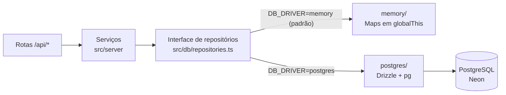

# Onde as informações ficam salvas

Este documento mostra onde cada dado do Triply é guardado (banco, navegador, caches), por quanto tempo, quem pode acessá-lo e como o app troca o banco em memória pelo PostgreSQL.

## Resumo em 30 segundos

- **Parte 1 (atual):** usuários, viagens, capas e tentativas de login ficam num **banco em memória** do servidor. É rápido e não exige instalar nada, mas é **volátil**: reiniciar o servidor devolve tudo ao estado inicial.
- **Parte 2 (pronta):** o mesmo código usa **PostgreSQL + Drizzle** quando se define `DB_DRIVER=postgres`. Rotas e front **não mudam**, porque os serviços só conversam com uma interface de repositórios.
- **Dados de demonstração têm ids fixos:** 6 contas, cada uma com a sua cópia das 7 viagens, voltam sempre iguais, e o login delas sobrevive a reinícios.
- **O navegador guarda só o cookie de sessão** (um JWT). Não usamos `localStorage`, `sessionStorage` nem `IndexedDB`.
- **Segurança:** a senha é guardada só como hash bcrypt, o cookie é `httpOnly`, cada pessoa só vê as próprias viagens (id alheio → `404`) e nenhum segredo vai para o repositório.

---

## 1. Mapa: o que é guardado e onde

| Dado | Onde fica | Por quanto tempo | Quem acessa |
|---|---|---|---|
| **Usuários** (nome, e-mail, hash bcrypt da senha) | Repositório `users` (memória) ou tabela `users` (PostgreSQL) | Memória: até reiniciar. PostgreSQL: permanente | Só o servidor. A API nunca devolve o hash |
| **Viagens** | Repositório `trips` / tabela `trips` | Igual ao usuário | Só o dono (`user_id`) |
| **Capas enviadas** (upload) | Os bytes da imagem no repositório: `Buffer` na memória; texto base64 na coluna `cover_image` no PostgreSQL | Igual à viagem | Só o dono, via `GET /api/trips/{id}/cover` |
| **Capas externas** | Só a **URL** (`cover_image` + `cover_image_source`); a foto fica no Wikimedia | Igual à viagem | O navegador baixa a imagem direto da URL |
| **Sessão** | **Cookie** `triply_session` (JWT) no navegador | 7 dias | O navegador o reenvia; o JavaScript não o lê; o servidor valida |
| **Tentativas de login que falharam** | Repositório `loginAttempts` (e-mail e IP só como HMAC) | Contam por 15 min; apagadas após 24 h | Só o servidor |
| **Caches das APIs externas** | Memória do servidor + Data Cache do Next | De 30 s a 30 dias (TTLs em [02-apis.md](02-apis.md)) | Só o servidor |
| **No navegador, além do cookie** | Nada | — | — |

**Sobre o navegador:** conferimos o código do front (`src/`) e não há uso de `localStorage`, `sessionStorage`, `IndexedDB` nem `document.cookie`. O estado das telas vive só na memória do React e é buscado de novo na API a cada carga. A foto enviada pelo usuário é reduzida no navegador (lado máximo de 1280 px, JPEG) em [`image.ts`](../../src/lib/image.ts), vai uma vez para a API e não fica guardada lá.

---

## 2. Banco em memória (parte 1)

**Repositório** é a camada que esconde *onde* os dados ficam: o serviço pede `repos.trips.list(userId)` sem saber se a resposta vem da memória ou do PostgreSQL.

- **Interfaces:** [`repositories.ts`](../../src/db/repositories.ts) define `UsersRepository`, `TripsRepository` e `LoginAttemptsRepository`, só com os métodos que os serviços usam. Os registros são tipos TypeScript puros em [`types.ts`](../../src/db/types.ts).
- **Store em `globalThis`:** os dados são `Map`s guardados em `globalThis.__triplyMemoryStore` ([`store.ts`](../../src/db/memory/store.ts)). `globalThis` é o objeto global do processo Node. Em desenvolvimento o Next recarrega módulos e pode ter várias cópias deles; sem isso, cada rota veria um banco diferente. O store nasce populado no primeiro acesso.
- **Seed com ids fixos** ([`seed-data.ts`](../../src/db/seed-data.ts)): 6 contas (`enzo@`, `tabata@`, `pietra@`, `vitor@`, `wesley@` e `adilson@triply.app`, senha `triply123`), cada uma com a **sua própria cópia das 7 viagens** (2 realizadas e 5 planejadas). Os ids das viagens do Enzo estão escritos no código; os das demais contas são derivados por hash, e portanto também fixos. **Por que fixos?** O cookie guarda o id do usuário. Se ele mudasse a cada reinício, o cookie apontaria para alguém que não existe e links como `/viagens/<id>` quebrariam.
- **Hash calculado uma vez:** como a senha de demonstração é a mesma, o bcrypt roda **uma vez** por processo (~70 ms) e o resultado é reaproveitado pelas 6 contas ([`demo.ts`](../../src/db/demo.ts)). O custo do *cold start* não cresce com o número de contas.
- **Cópias defensivas:** o repositório devolve **cópias** (`structuredClone`) e copia o que recebe ao gravar. Quem altera o objeto devolvido não muda o "banco" sem passar pelo repositório, como num banco de verdade, onde a resposta chega de fora.
- **Arredondamento igual ao NUMERIC:** o PostgreSQL arredonda ao gravar (`numeric(14,6)` para cotação, 1 casa para temperatura, 2 para gastos). Em JavaScript, números decimais têm pequenos erros (`5e-7` não vale exatamente 0,0000005). [`numeric.ts`](../../src/db/memory/numeric.ts) arredonda pelos dígitos decimais, metade para longe do zero (0,0000005 → 0,000001). Comparamos com o PostgreSQL real em milhares de valores, sem diferença. Assim a API responde igual nos dois bancos, e o mesmo vale para ordem das listas, e-mail único e `404` em viagem alheia.

### O que é volátil, e por quê

A memória do **processo** some quando o processo acaba. Isso acontece em quatro situações:
1. **Reinício** do servidor (`npm run dev` de novo).
2. **Novo deploy** na Vercel.
3. **Cold start:** na Vercel (plataforma *serverless*, em que o servidor liga sob demanda) uma instância ociosa é desligada e a próxima requisição sobe uma nova, **do zero**.
4. **Outra instância:** cada instância da função tem a **sua** memória. Duas requisições seguidas podem cair em instâncias diferentes; com pouco tráfego costuma ser a mesma, mas não há garantia.

**Na demonstração, isso significa:**
- As **6 contas e as 7 viagens de cada uma são estáveis**: fazem parte do seed e reaparecem iguais em qualquer instância.
- O que for **criado ou editado** pode desaparecer. Uma conta criada pelo cadastro pode sumir (o próximo acesso responde `401` e o app pede novo login), e o contador de tentativas de login vale só por instância.
- Se uma edição "voltar sozinha" ao vivo, não é bug: é a limitação da parte 1 e o motivo da parte 2. Para apresentar, use as contas de demonstração.

---

## 3. Modelo de dados


- **`USERS` 1 → N `TRIPS`:** toda viagem pertence a um usuário (`ON DELETE CASCADE`: apagar o usuário apaga as viagens).
- **Regras no próprio banco** ([`schema.ts`](../../src/db/postgres/schema.ts)): e-mail único e em minúsculas; `end_date ≥ start_date`; nota de 1 a 5; gastos ≥ 0; índice em `(user_id, status)` para listar rápido.
- **`cover_image`** guarda a URL externa **ou** o upload (data URL, base64). A API nunca o devolve nas listas: monta `coverImageUrl` como `/api/trips/{id}/cover?v=<updatedAt>` ([`serialize.ts`](../../src/server/trips/serialize.ts)).
- **`LOGIN_ATTEMPTS`** não se liga a ninguém: guarda só HMACs, para limitar tentativas sem registrar e-mail ou IP.
- Os registros em memória têm os mesmos campos ([`types.ts`](../../src/db/types.ts)); o contrato com o front é `Trip`, em [`src/types/api.ts`](../../src/types/api.ts).

---

## 4. Parte 2 — PostgreSQL

**Para ligar** (os valores ficam em `.env.local`, que não vai para o Git; abaixo, só placeholders):

```bash
DB_DRIVER=postgres
DATABASE_URL=<url de conexão do seu PostgreSQL>   # nunca versionar o valor real
npm run db:migrate   # cria as tabelas
npm run db:seed      # grava as 6 contas de demonstração (mesmos dados e ids da memória)
npm run dev          # o log mostra: [db] PostgreSQL (...) — os dados são persistentes
```

Em produção usaríamos o **Neon** (PostgreSQL gerenciado, instalado pelo Marketplace da Vercel): `DATABASE_URL` com a conexão "pooled" e `DATABASE_URL_UNPOOLED` para as migrações (passo a passo no [README](../../README.md)).

- **Drizzle** é um **ORM** (*Object-Relational Mapper*): descrevemos as tabelas em TypeScript ([`schema.ts`](../../src/db/postgres/schema.ts)) e ele cuida do SQL. **Migração** é um script SQL versionado que leva o banco de uma versão do esquema à seguinte: `npm run db:generate` cria uma a partir do `schema.ts` (ficam em [`drizzle/`](../../drizzle/): `0000_init.sql` e `0001_login_attempts.sql`) e `npm run db:migrate` aplica as pendentes.
- **O que muda para quem usa:** os dados passam a ser **permanentes**, valem para todas as instâncias (inclusive o limite de login) e o seed deixa de ser a "fonte da verdade".

**Por que a troca não mexe em rotas nem no front.** As rotas chamam serviços; os serviços só importam `repos`, a fachada de [`src/db/index.ts`](../../src/db/index.ts), que lê `DB_DRIVER` e carrega a implementação por `import()` dinâmico (em modo memória, `pg` e Drizzle nem são carregados). Uma regra do ESLint **proíbe** importar Drizzle ou `pg` fora de `src/db/postgres/`. As duas implementações devolvem os mesmos tipos e foram comparadas com os mesmos cenários, sem diferença nas respostas.



---

## 5. Segurança dos dados

- **Senha:** guardada só como hash **bcrypt** (custo 10; o *salt*, um tempero aleatório por senha, vai dentro do hash). Nunca em texto, e [`serializeUser`](../../src/server/users/serialize.ts) a omite de toda resposta. O login erra sempre com a mesma mensagem ("E-mail ou senha incorretos.") e, se o e-mail não existe, gasta o mesmo tempo ([`password.ts`](../../src/server/auth/password.ts)), para não revelar quem tem conta.
- **Cookie `httpOnly`:** o navegador o envia sozinho, mas o JavaScript da página não o lê, então um script malicioso não o rouba. Também é `SameSite=Lax` e `Secure` em produção (só por HTTPS). O JWT é assinado com `JWT_SECRET`; o detalhe está em [03-conexao-front-back.md](03-conexao-front-back.md).
- **Cada usuário só vê as suas viagens:** *IDOR* (*Insecure Direct Object Reference*) é ler dado alheio trocando o id na URL. Aqui todo método do repositório recebe o `userId` **da sessão** e filtra por ele. Viagem de outro usuário responde `404`, igual a uma inexistente, para não confirmar que existe. Testamos 150 tentativas cruzadas entre as 6 contas (ler, capa, editar, apagar, concluir): todas `404`.
- **Nenhum segredo no repositório:** `.env*` está no [`.gitignore`](../../.gitignore) (só o `.env.example`, sem valores reais, é versionado). `JWT_SECRET` e `DATABASE_URL` entram como variáveis de ambiente no ambiente de execução (Vercel), e o código se recusa a funcionar com um `JWT_SECRET` ausente ou com menos de 32 caracteres. As APIs externas não exigem chave. A senha `triply123` é pública **de propósito**: é só das contas de demonstração.
- **Ainda:** limite de tentativas de login (`429`), conferência de `Origin` nas escritas e cabeçalhos como `X-Frame-Options: DENY`.

## Para a apresentação

- **Frase central:** "na parte 1 os dados vivem na memória do servidor; a interface de repositórios deixa o PostgreSQL entrar na parte 2 sem mexer em rotas nem no front".
- **Seja franco sobre a volatilidade:** explique que reinício, deploy e cold start devolvem o app ao seed, e que por isso as contas de demonstração têm ids fixos.
- **Segurança em 3 frases:** senha só em hash, cookie que o JavaScript não lê, e um usuário nunca enxerga os dados do outro.
- **Ao vivo (1):** entre como Enzo, edite a hospedagem de um plano, saia e entre como Tabata: a mesma viagem está intacta. **Cada conta tem a sua cópia.**
- **Ao vivo (2):** no DevTools (aba *Application*), mostre o cookie `triply_session` com **HttpOnly** marcado e o *Local Storage* vazio.
- **Ao vivo (3):** no [`/api-docs`](https://triply-kappa-sepia.vercel.app/api-docs), logue como Tabata e peça `GET /api/trips/20260f1d-c050-4ac7-ad2b-177070b8fd63` (id de uma viagem do Enzo): a resposta é `404`.
- **Se rodar local:** mostre no terminal o aviso `[db] banco em memória — ...` e, com `DB_DRIVER=postgres`, o `[db] PostgreSQL (...)`.
