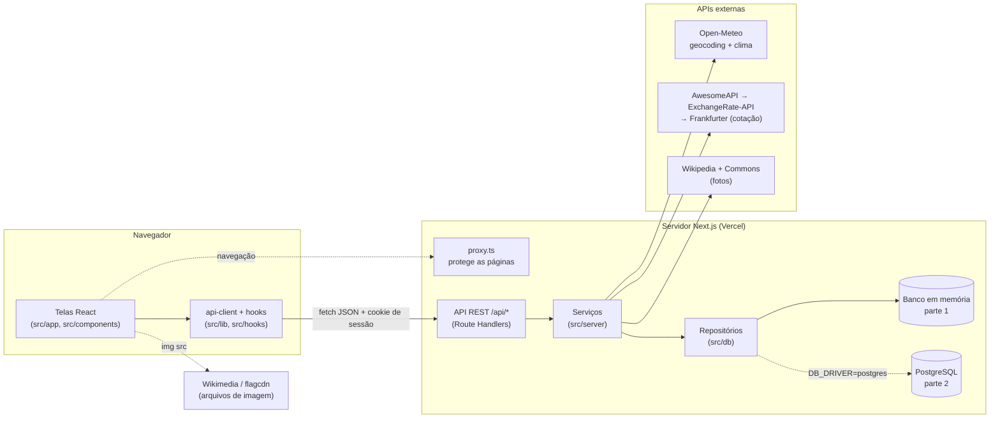

# Guia do Triply

Material de estudo e de apresentação do projeto: como o app funciona, quais APIs usa, como o front conversa com o back e onde os dados ficam salvos.

## Resumo em 30 segundos

- **O que é:** um web app para **planejar viagens** e depois **registrar como foram**. Ele foi feito a partir de um protótipo mobile do Figma e adaptado para web.
- **APIs próprias:** o back-end expõe uma **API REST** em `/api/*` (15 operações). O front só conversa com ela.
- **APIs externas:** Open-Meteo (destinos e clima), AwesomeAPI → ExchangeRate-API → Frankfurter (cotação), Wikipedia/Wikimedia Commons (fotos) e flagcdn (bandeiras). Todas são consumidas **pelo servidor**.
- **Dados:** nesta parte 1, ficam num **banco em memória** no servidor. O **PostgreSQL** já está pronto para a parte 2 e é ligado com uma variável de ambiente.
- **No ar:** https://triply-kappa-sepia.vercel.app (Vercel), com documentação interativa em [`/api-docs`](https://triply-kappa-sepia.vercel.app/api-docs).

## O Triply em uma imagem

Como ler o diagrama:
1. As **telas** nunca falam com o banco nem com as APIs externas. Elas chamam a **API própria** (`/api/...`) por meio de um cliente HTTP único.
2. Cada rota da API valida a entrada, confere quem está logado e chama um **serviço** com a regra de negócio.
3. Os serviços leem e gravam por meio de **repositórios**. Hoje a implementação é em memória; na parte 2 basta trocar para PostgreSQL, sem mexer nas rotas nem no front.
4. Quando é preciso enriquecer um destino (bandeira, moeda, clima, foto), os serviços consultam as **APIs externas**. As respostas ficam em cache e, se uma API falhar, só aquele pedaço fica vazio.
5. O navegador baixa direto apenas os **arquivos de imagem** (fotos da Wikimedia e bandeiras da flagcdn), pelas URLs que a API devolveu.

## Os documentos

| # | Documento | Pergunta que responde |
|---|---|---|
| 1 | [Visão geral — como o Triply funciona](01-visao-geral.md) | O que o app faz, quais são as telas, com que tecnologias foi feito e como rodar? |
| 2 | [APIs — próprias e externas](02-apis.md) | Quais APIs criamos, quais consumimos e como lidamos com falhas e cache? |
| 3 | [Conexão front ↔ back](03-conexao-front-back.md) | Como uma tela pede dados ao servidor, como funciona o login e como os erros voltam? |
| 4 | [Armazenamento de dados](04-armazenamento-de-dados.md) | Onde cada informação fica salva, o que é volátil e como entra o PostgreSQL? |

Referências mais detalhadas, para quando precisar do detalhe fino:
- [`docs/API.md`](../API.md): referência completa dos endpoints, com exemplos de requisição e resposta.
- [`docs/SPEC.md`](../SPEC.md): especificação do produto (telas, design system, modelo de dados, decisões).
- [`docs/qa/relatorio-qa.md`](../qa/relatorio-qa.md): relatório de testes (funcionais, de segurança e de regressão).
- Página [`/sobre`](https://triply-kappa-sepia.vercel.app/sobre) do app: a arquitetura explicada dentro do próprio produto.

## Requisitos da disciplina → onde estão atendidos

| Requisito (DSW3) | Como o Triply atende | Onde ver |
|---|---|---|
| APIs próprias para o front se comunicar com o back | API REST em `/api/*`: autenticação, perfil, viagens, destinos e documentação | [02-apis.md](02-apis.md) · [`/api-docs`](https://triply-kappa-sepia.vercel.app/api-docs) |
| Consumo de API externa | Open-Meteo, cotação de moedas (3 provedores com fallback), Wikipedia/Commons e flagcdn | [02-apis.md](02-apis.md) · painel de insights em "Novo plano" |
| Telas a partir do protótipo | As telas do Figma mobile, adaptadas para web responsivo | [01-visao-geral.md](01-visao-geral.md) |
| Banco em memória (parte 1) | Repositórios em memória, com PostgreSQL pronto para a parte 2 | [04-armazenamento-de-dados.md](04-armazenamento-de-dados.md) |
| Hospedagem para apresentar | Deploy na Vercel | https://triply-kappa-sepia.vercel.app |

## Contas de demonstração

Todas usam a senha **`triply123`**. Cada conta tem a **sua própria cópia** das 7 viagens de demonstração (2 realizadas e 5 planejadas), então o que uma pessoa edita não aparece para as outras.

| Nome | E-mail |
|---|---|
| Enzo Rodrigues | `enzo@triply.app` |
| Tabata | `tabata@triply.app` |
| Pietra | `pietra@triply.app` |
| Vitor | `vitor@triply.app` |
| Wesley | `wesley@triply.app` |
| Adilson | `adilson@triply.app` |

> Contas criadas pelo cadastro funcionam normalmente, mas, como o banco é em memória, somem quando o servidor reinicia. As contas acima fazem parte dos dados iniciais e voltam sempre iguais.

## Glossário rápido

| Termo | Em uma frase |
|---|---|
| **API REST** | Um conjunto de URLs (`/api/trips`, `/api/profile`...) que recebem e devolvem JSON, usando os métodos HTTP (GET lê, POST cria, PATCH altera, DELETE apaga). |
| **JSON** | Formato de texto para trocar dados entre front e back (`{"destination": "Paris"}`). |
| **Route Handler** | Arquivo `route.ts` do Next.js que responde a uma URL da API, no servidor. |
| **JWT** | Um "crachá" digital assinado pelo servidor que diz quem é o usuário. Fica num cookie. |
| **Cookie httpOnly** | Cookie que o navegador envia sozinho em cada requisição e que o JavaScript da página não consegue ler, o que protege a sessão. |
| **Cache** | Guardar por um tempo a resposta de uma API externa para não perguntar de novo a cada acesso. |
| **Repositório** | Camada que esconde *onde* os dados ficam. Os serviços pedem "salve esta viagem" sem saber se é memória ou PostgreSQL. |
| **ORM (Drizzle)** | Biblioteca que transforma código TypeScript em comandos SQL (usada na parte 2). |
| **Serverless / cold start** | Na Vercel, o servidor liga sob demanda. Quando ele "acorda" do zero (cold start), a memória começa vazia e os dados iniciais são carregados de novo. |
| **OpenAPI** | Padrão para descrever uma API. Gera a documentação interativa de `/api-docs`. |

## Para a apresentação

- **Abra com o diagrama acima:** front → API própria → serviços → repositórios e APIs externas. Ele resume o trabalho inteiro.
- **Siga a ordem dos documentos** como roteiro: o que o app faz (1), quais APIs (2), como o front fala com o back (3) e onde ficam os dados (4).
- **Demonstração ao vivo sugerida:**
  1. Entrar com uma conta de demonstração.
  2. Criar um plano: buscar um destino e mostrar o painel com bandeira, cotação, clima e foto vindos das APIs externas.
  3. Registrar uma viagem como realizada e ver o perfil atualizar.
  4. Abrir o `/api-docs` e executar uma rota com "Try it".
- **Uns minutos antes de apresentar,** abra o app uma vez com cada destino da demonstração. Isso "acorda" o servidor e deixa as respostas das APIs externas em cache.
